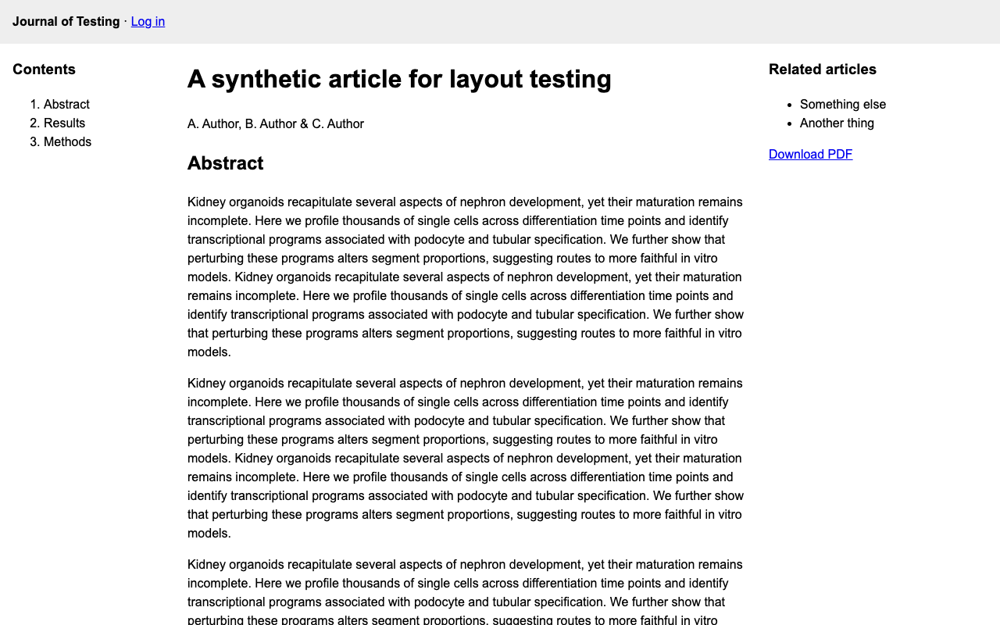
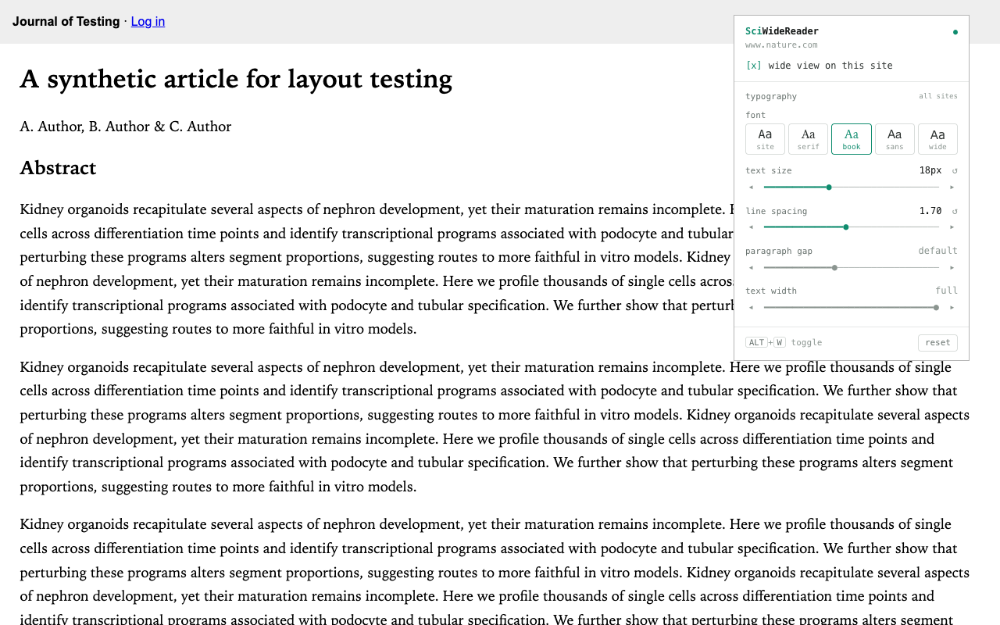

<p align="center"></p>

# SciWideReader

[](https://github.com/cstocker45/SciWideReader/actions/workflows/ci.yml)

Chrome extension that hides sidebars on journal websites (Nature, Cell, Science, PNAS, PMC, bioRxiv, eLife, …) so the article text and figures use the full width of the browser. Includes a menu for font, text size, line spacing, paragraph spacing and text width.

**Website, download & live publisher status:** https://cstocker45.github.io/SciWideReader/

| before | after |
|---|---|
|  |  |

## Install

- **Chrome Web Store:** *(link coming once the listing is approved)*
- **Manual:** download [SciWideReader.zip](https://cstocker45.github.io/SciWideReader/SciWideReader.zip), unzip, open `chrome://extensions`, enable *Developer mode*, *Load unpacked* → the unzipped folder (or the `extension/` folder of this repo).

Toolbar icon opens the menu; **Alt+W** toggles the current site.

## How it works

`extension/content.js` finds the element holding the most paragraph text (the article), walks up its ancestors and hides any sibling that sits *beside* the article (overlaps vertically, not horizontally), then widens each ancestor. A second pass on the widened layout catches panels that appear late or float over the text (sticky "PDF / Cite / Share" rails). No publisher-specific selectors.

## Development

```bash
python3 -m venv .venv && .venv/bin/pip install playwright pytest pillow
.venv/bin/playwright install chromium
cd tests
../.venv/bin/pytest -q                 # extension on synthetic layouts (headless Chromium)
../.venv/bin/python live_check.py      # real open-access articles per publisher
HEADED=1 ../.venv/bin/pytest -q        # watch it run
```

- `tests/fixtures.py`: synthetic journal layouts (flex, grid, floats, nested, late-loading sidebars, floating rails). Served on `https://www.nature.com/wr-test/…` through request interception so the content script injects exactly as on the real site.
- `tests/publishers.json`: one open-access article per publisher for the live check. A *blocked* result means the publisher's bot protection refused the automated visit; it is reported, not counted as a failure.
- `store/make_icons.py`, `store/make_screenshots.py`: regenerate the ASCII icon set and store screenshots.

## CI / CD

| workflow | trigger | does |
|---|---|---|
| `ci.yml` | push, PR, daily 06:17 UTC | unit tests → live publisher check → builds and deploys the GitHub Pages site (zip + status table) |
| `release.yml` | tag `vX.Y` | tests → GitHub Release with zip → Chrome Web Store upload & publish (if `CWS_*` secrets are set) |

Releasing: bump `version` in `extension/manifest.json`, commit, `git tag v1.3 && git push --tags`.

Chrome Web Store auto-publish needs repo secrets `CWS_CLIENT_ID`, `CWS_CLIENT_SECRET`, `CWS_REFRESH_TOKEN` and variable `CWS_EXTENSION_ID` ([how to get them](https://github.com/fregante/chrome-webstore-upload-keys)). Set variable `CWS_URL` to show the *Add to Chrome* button on the site.

## License

MIT
